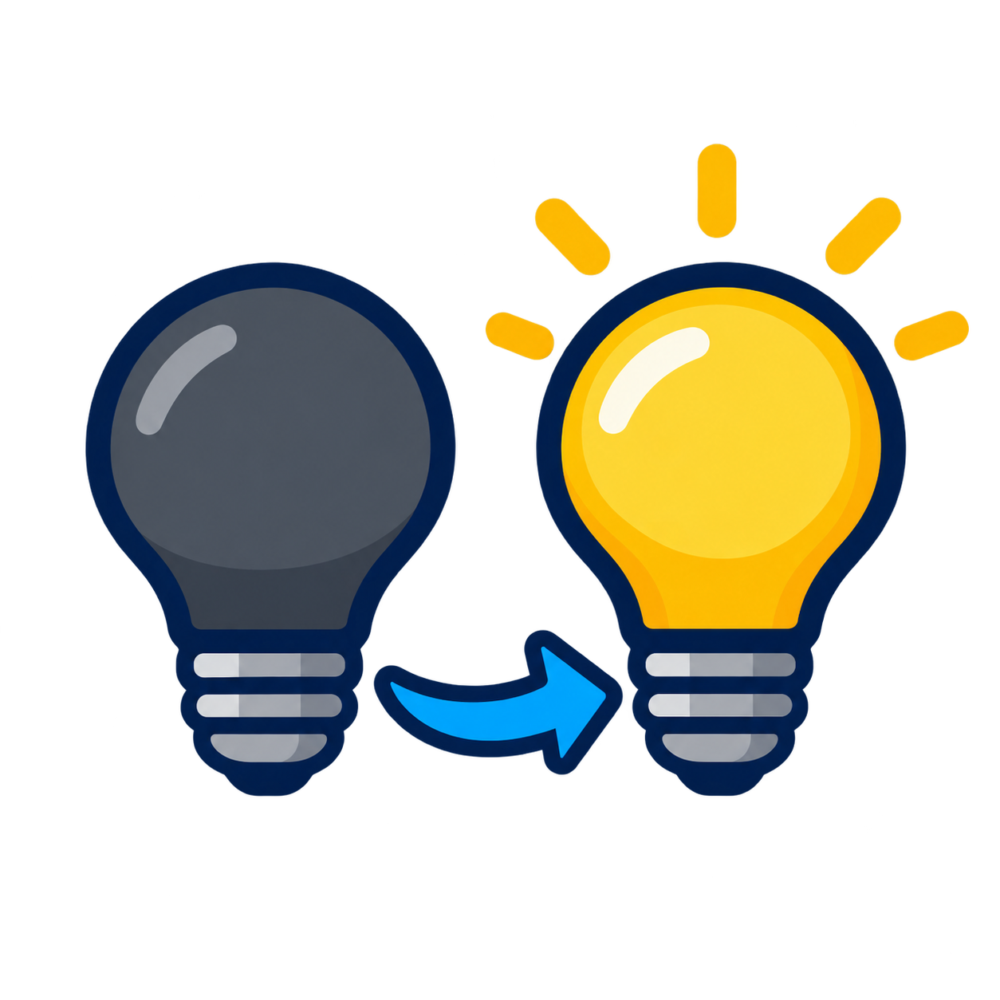

# Light Bulb Replacement Wizard

[](https://github.com/BjornRonnestad/HA_LightBulbReplacementWiz/actions/workflows/validate.yml)
[](https://github.com/BjornRonnestad/HA_LightBulbReplacementWiz/actions/workflows/tests.yml)



A custom Home Assistant integration that helps you replace a light bulb while
keeping its existing name and entity ID. Groups, scenes, automations, scripts
and dashboards that reference that entity ID can then use the replacement bulb.

The new bulb must already be added to Home Assistant through its normal
integration. This wizard does not pair devices.

Version **0.2.3** supports copying bindings and Zigbee group memberships through
**ZHA or Zigbee2MQTT**, with a preview, confirmation and undo. Zigbee2MQTT
discovery uses its cached bridge records; see the limitations below.

## Features

- Select the old and new bulbs using Home Assistant entity pickers.
- Rename the old bulb with an `_OLD` display-name suffix and an `_old` entity-ID
  suffix, then disable its HA entity without deleting it.
- Give the new bulb the original name and entity ID.
- Transfer the effective area, aliases and custom icon. Add the old entity's and
  device's labels to the new entity's existing labels.
- Detect ID collisions and known device-ID or registry-UUID references that need
  manual changes.
- Optionally discover and copy compatible bindings and Zigbee groups through
  ZHA or Zigbee2MQTT on the same network.
- Undo the last replacement or recover an interrupted operation.
- English interface text, including when Home Assistant uses Norwegian Bokmål.
- Bundled integration icon showing an unlit bulb replaced by a working bulb.

## Requirements

- **Home Assistant 2026.10 or newer.** Tested with Core **2026.10.2**.
- Two registered `light` entities. Light groups cannot be selected as bulbs.
- The new bulb must be enabled and available. The old bulb may be offline, but
  its entity must still exist in Home Assistant.
- For **ZHA** binding/group copying, both bulbs must be on the same running ZHA
  network. The adapter was developed against ZHA **2.3.1** and Zigpy **2.3.0**.
- For **Zigbee2MQTT** binding/group copying, both bulbs must be discovered through
  the HA **MQTT** integration and registered on the same Zigbee2MQTT bridge. HA
  must already be connected to that bridge's MQTT broker. The bridge must publish
  `bridge/state`, `bridge/info`, `bridge/devices` and `bridge/groups`, and support
  the documented binding/group request API. Use a current Zigbee2MQTT release.
- Binding copying between ZHA and Zigbee2MQTT, or between different networks,
  is not supported. Entity-ID replacement can be used independently of copying.

Bulb replacement has been tested successfully by the maintainer on a physical
ZHA setup in Home Assistant. This confirms the tested replacement flow on that
setup; it does not establish hardware validation of every binding, group, undo
or recovery scenario. Automated tests also use simulated bulbs and radio
responses. Physical Zigbee2MQTT hardware has **not yet been tested**.

## Installation

### HACS: custom repository

This integration is not listed in the default HACS catalog. If you already have
[HACS](https://www.hacs.xyz/) installed:

[Open this repository in HACS](https://my.home-assistant.io/redirect/hacs_repository/?owner=BjornRonnestad&repository=HA_LightBulbReplacementWiz&category=integration),
or add it manually:

1. Open **HACS** in Home Assistant.
2. Open the three-dot menu and select **Custom repositories**.
3. Enter this repository URL:

   ```text
   https://github.com/BjornRonnestad/HA_LightBulbReplacementWiz
   ```

4. Select **Integration** as the type and click **Add**.
5. Find **Light Bulb Replacement Wizard** in HACS and download it.
6. **Restart Home Assistant.** Reloading YAML is not sufficient.
7. Follow [Add the integration](#add-the-integration) below.

### Manual installation

1. [Download the repository ZIP](https://github.com/BjornRonnestad/HA_LightBulbReplacementWiz/archive/refs/heads/main.zip)
   and extract it.
2. Copy the `custom_components/light_bulb_replacement` folder into your Home
   Assistant configuration directory. Copy only this integration folder, not
   the entire repository. The resulting layout must be:

   ```text
   config/
   └── custom_components/
       └── light_bulb_replacement/
           ├── __init__.py
           ├── brand/
           │   └── icon.png
           ├── config_flow.py
           ├── const.py
           ├── manifest.json
           ├── replacement.py
           ├── strings.json
           ├── translations/
           │   ├── en.json
           │   └── nb.json
           ├── z2m.py
           └── zha.py
   ```

   On Home Assistant OS, the configuration directory is normally `/config`.
   Create `custom_components` if it does not exist.
3. **Restart Home Assistant.**
4. Follow the setup instructions below.

## Add the integration

1. Open **Settings → Devices & services**.
2. Click **Add integration**.
3. Search for **Light Bulb Replacement Wizard** and complete the setup.

No YAML configuration is required. Add the wizard once and use **Configure** for
subsequent replacements.

After installing the files and restarting HA, you can also
[open the integration setup directly](https://my.home-assistant.io/redirect/config_flow_start/?domain=light_bulb_replacement).

## Replace a bulb

1. Add the replacement bulb to Home Assistant using ZHA, Zigbee2MQTT, Hue, Matter
   or its usual integration. Check that you can control it.
2. Open **Settings → Devices & services → Light Bulb Replacement Wizard →
   Configure**.
3. Select **Replace bulb**.
4. In **Old bulb**, select the `light` entity you want to replace.
5. In **New bulb**, select the replacement `light` entity. These must be two
   different entities.
6. Optionally enable copying for **one** backend: **Discover and copy ZHA bindings
   and Zigbee groups** or **Discover and copy Zigbee2MQTT bindings and Zigbee
   groups**. For Zigbee2MQTT, enter the MQTT base topic (normally `zigbee2mqtt`);
   leave endpoint fields empty for automatic selection. Wake affected battery
   remotes before copying.
7. Review the proposed changes and resolve any blocking references. Take a Home
   Assistant backup and pause affected automations before confirming: state
   changes during replacement may trigger them.
8. Confirm the replacement. Test an existing group, scene and automation, then
   re-enable the automations you paused. If you copied bindings, test the
   physical controls as well.

### Example

| Bulb | Before | After |
| --- | --- | --- |
| Old bulb | `light.living_room` | `light.living_room_old`, disabled |
| New bulb | `light.new_bulb` | `light.living_room` |

The old display name becomes `Living room_OLD`; the new bulb takes the original
`Living room` name. Entity IDs use lowercase `_old` because HA entity IDs must
be lowercase. If the proposed archive ID already exists, the wizard stops.

Hardware **unique IDs, device IDs, registry UUIDs and owning integrations remain
unchanged**. Existing references to `light.living_room` target the new bulb;
references to `light.new_bulb` must be cleaned up manually.

## ZHA bindings and Zigbee groups

A binding from a remote to a bulb is stored on the **remote**. The wizard
therefore reads binding tables across the ZHA network, including remotes and
the coordinator. Large networks can take several minutes to scan. Keep battery
remotes awake during scanning, copying and recovery.

The preview lists incoming and outgoing bindings for the selected light
endpoint, its Zigbee groups, unread devices and incompatible bindings. The
wizard uses each light's actual ZHA endpoint, even when the endpoint numbers
differ. It does not replace the entities or group memberships of other channels.

Only compatible bindings are copied. Missing clusters, different Zigbee profiles
and manufacturer-specific clusters block copying. For a remote bound to a
Zigbee group, adding the new bulb to that group preserves the remote's existing
group binding.

If the old bulb is dead, its own binding table cannot be read. Incoming bindings
may still be found on other devices, and known group memberships can be taken
from ZHA's cache. Incomplete results are marked explicitly. You must rescan or
accept copying only the known entries; an empty result with read failures does
not establish that no bindings exist.

Every addition is recorded before sending the command, and bindings and group
memberships are read back to verify the result before the entity IDs are swapped.
Existing entries on the new bulb and original entries on the old bulb are
preserved. Both bulbs may therefore respond to physical controls, even after
the old HA entity is disabled. Disconnect the old bulb after checking the new
one, and keep it registered in ZHA while you still need the undo option.

A full binding table may need manual cleanup before another binding can be added.
On-device Zigbee scenes, attribute reporting settings and manufacturer-specific
configuration are not copied. The wizard uses ZHA's existing gateway; it does
not open a second connection to the radio adapter.

## Zigbee2MQTT bindings and Zigbee groups

Select both bulbs in the normal HA entity pickers and enable **Discover and copy
Zigbee2MQTT bindings and Zigbee groups**. On the next page, enter the bridge's
**MQTT base topic**, normally `zigbee2mqtt`. Custom topics such as
`house/zigbee` are supported. The wizard uses HA's existing MQTT connection;
it does not need broker credentials or a separate Zigbee adapter connection.

Endpoints are selected automatically for single-channel bulbs or when the
selected HA light can be matched to a named Zigbee2MQTT endpoint. For ambiguous
multi-channel devices, enter the old and new numeric endpoint IDs shown in
Zigbee2MQTT. The wizard refuses to guess between multiple light channels.

The preview finds incoming and outgoing bindings involving the selected light
endpoint in **Zigbee2MQTT's cached `bridge/devices` records**, plus membership in
its `bridge/groups` records. It copies supported standard clusters and adds the
new bulb to the old bulb's known groups. Other channels are left out of the
replacement. Incompatible or manufacturer-specific bindings block copying.

**Cached discovery is always marked incomplete.** The MQTT API does not provide
an equivalent of ZHA's network-wide direct binding-table scan. Missing or stale
bridge records may hide bindings or group memberships, even if the preview is
empty. Review the preview and explicitly accept copying only known records.
The old bulb may be offline, but keep it registered on the bridge for discovery
and undo.

Before writing, the wizard checks the bridge is responding, verifies the selected
network and endpoints, and records existing bindings/memberships as the baseline.
Each addition is journaled before sending it, uses a unique MQTT transaction ID,
and requires both a successful command response and a matching bridge metadata
update. This verifies the bridge's view; it **does not independently read back
the physical device's binding or group table**. Test your physical controls.

Original entries are retained, so both bulbs may respond until the old one is
disconnected. Undo removes the requested additions and preserves entries that
were already recorded on the new bulb. Lost acknowledgements and interruptions
retain enough information to retry removal of the requested additions. Recovery
requires the original MQTT base topic, coordinator and Zigbee network.

Zigbee2MQTT's normal bind/group commands may automatically configure reporting
or add coordinator bindings. Those side effects are not restored by undo.
The wizard requests that unbinding/group removal does not disable reporting.
Unrecorded device settings, on-device Zigbee scenes, arbitrary external MQTT
topic references and Zigbee2MQTT friendly names are not migrated. HA entity
names and IDs are changed in HA; MQTT topics and Zigbee2MQTT device names remain
as configured on the bridge.

The adapter follows the documented [Zigbee2MQTT MQTT API](https://www.zigbee2mqtt.io/guide/usage/mqtt_topics_and_messages.html).
Automated tests simulate the bridge API; physical Zigbee2MQTT hardware has not
yet been tested.

## What still needs manual attention?

| Item | Behavior |
| --- | --- |
| Explicit entity-ID references in HA groups, scenes, automations, scripts and dashboards | Keep the original ID and target the replacement bulb. |
| Device-ID references in loaded automations and scripts | Known references block replacement. Change suitable actions to entity targets or rebuild hardware-specific triggers. |
| Registry UUIDs in config-entry data or options | Known references block replacement; update the affected helper or integration first. |
| Area and labels | Copied to the entity. Shared devices and their other entities are not moved. If the old bulb has no area but the new device supplies an inherited area, resolve this before replacing. |
| Brightness, color, effects and color temperature | Available color modes and feature flags are compared when the old state is available. Scene values are not converted; check the new bulb's capabilities and Kelvin range. |
| Zigbee2MQTT bindings and groups | Optional copying uses cached bridge records with explicit acknowledgement. Unknown physical bindings and automatic reporting changes need manual checks. |
| Hue and other backend bindings/groups | Configure these in their original integration. Automatic copying supports ZHA and Zigbee2MQTT only. |
| History and statistics | Not migrated; continuous history for new hardware is not guaranteed. |
| Assist, Alexa, Google and integration-specific exposure settings | Review manually; these may not follow the entity ID. |
| Unloaded automations, dynamic templates and external systems | Cannot be fully inventoried and must be checked manually. |
| Other entities on the old device | Power sensors, additional light channels and other entities are not replaced. |

## Undo and recovery

Open **Configure → Undo / recover last replacement** to restore the original
entity IDs and settings, including enabled state. Only the most recent
replacement is retained. Starting another replacement replaces the previous
undo record.

Undo overwrites later changes to the recorded names, areas, icons, aliases and
labels. For ZHA or Zigbee2MQTT copying, it also removes the requested bindings
and group memberships added by this wizard, while preserving entries already
known to the selected backend. Keep the original backend and affected devices
available during recovery. For Zigbee2MQTT, cached discovery and automatic
reporting side effects have the limitations described above.

A persistent journal supports rollback on failure and recovery after
interruption. An unfinished operation blocks further replacements until it is
recovered. Recovery refuses to overwrite entity IDs now owned by unrelated
entities, and refuses radio changes on a different Zigbee network or coordinator.
The integration uses HA's registry and storage APIs rather than editing HA's
registry or YAML files directly.

This is not a full HA transaction: history, already triggered automations and
unrelated external changes cannot be undone by the wizard. Keep your HA backup.

## Troubleshooting

- **Integration not found:** check the folder layout above and restart Home
  Assistant completely. The directory must be named `light_bulb_replacement`.
  Early development builds registered the wizard as a helper, placing it under
  **Settings → Devices & services → Helpers**. Update to the release version and
  restart to make it available under **Add integration**. Also check the minimum
  Home Assistant version listed above.
- **New bulb unavailable:** finish pairing in its normal integration and confirm
  that the bulb can be controlled before opening the wizard.
- **Archive ID already exists:** rename the existing `_old` entity in HA or undo
  the previous replacement before trying again.
- **ZHA scan incomplete:** wake the listed remotes, check device connectivity and
  scan again. Keep the old bulb registered in ZHA.
- **Zigbee2MQTT bridge unavailable:** verify HA MQTT is connected to the same
  broker, check the exact base topic and allow read access to the bridge topics
  plus publish access to `bridge/request/#`. The bridge must answer health checks.
- **Zigbee2MQTT endpoint ambiguous:** enter numeric endpoint IDs on the connection
  page; check the selected light channel in Zigbee2MQTT.
- **Recovery required:** make the affected devices available, then use
  **Undo / recover last replacement** before attempting another replacement.
- **More detail needed:** open **Settings → System → Logs** and look for
  `light_bulb_replacement` entries.

## Updating and removing

For HACS installations, download updates through HACS and restart Home Assistant.
For manual installations, replace only the integration's folder with the updated
files and restart.

Removing this integration does not undo replacements. If you want to restore the
last replacement, run undo first. You can then remove the wizard from
**Settings → Devices & services**, remove its files through HACS or manually,
and restart Home Assistant.

## Development

Release preparation and default HACS catalog submission are documented in
[RELEASING.md](RELEASING.md). This project is licensed under the [MIT License](LICENSE).

Use Python **3.14.2+** and `uv`:

```sh
uv sync --frozen
uv run pytest -q
uv run ruff check .
uv run ruff format --check .
```

Tests exercise real HA components and configuration flows with simulated bulbs.
ZHA tests use real Zigpy endpoints and protocol types with simulated radio
responses, including incoming/outgoing bindings, group membership, lost
acknowledgements and interrupted recovery. Zigbee2MQTT tests simulate retained
bridge metadata, correlated command responses, delayed metadata updates, failures
and crash recovery through HA's actual wizard flows. They do not modify a
physical HA installation or Zigbee devices.

For Codex cloud tasks, use the existing checkout: each task already has an
isolated environment, so an additional Git worktree is unnecessary.
